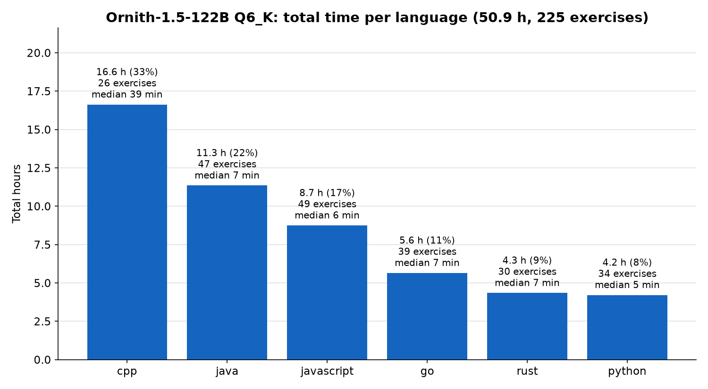
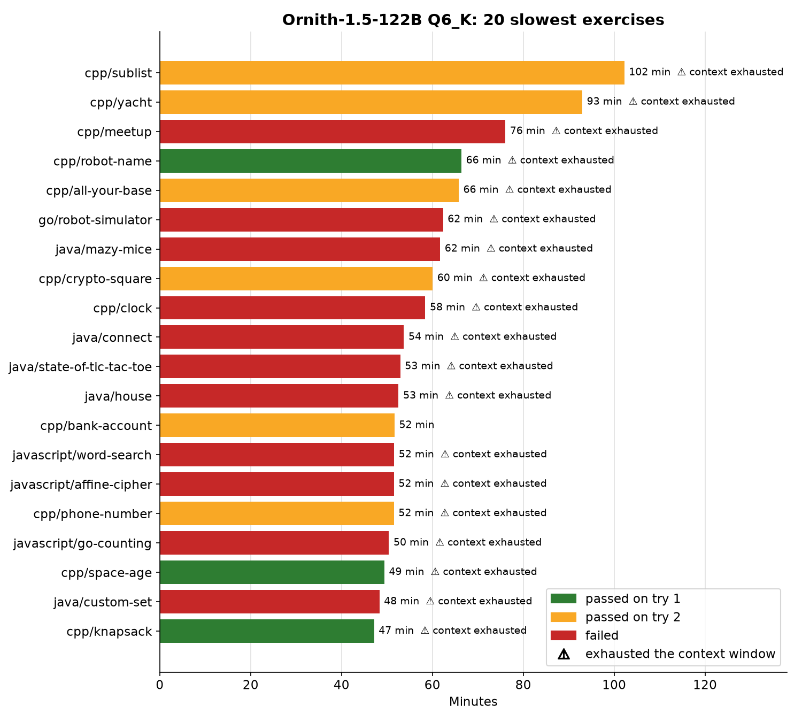
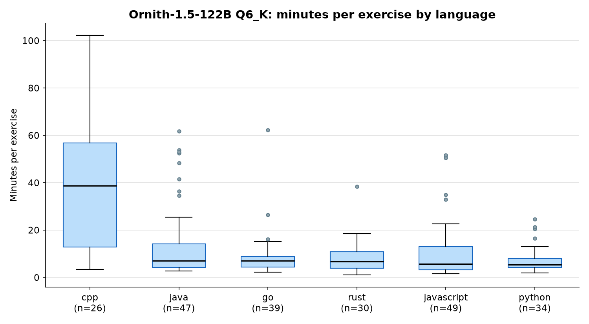
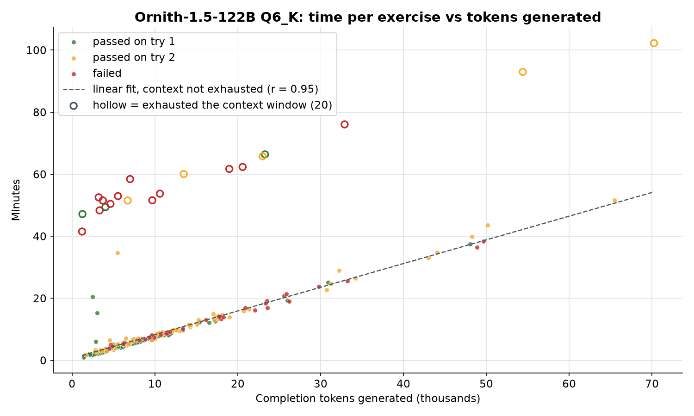

# Ornith-1.5-122B Q6_K: Aider Polyglot results

`stats.json` and `per_exercise.csv` are the run's summary and per-exercise results.

Summary (from the run log, `aider.log`):

- 225/225 finished, 0 crashed
- pass_rate_1 = 47.6%, pass_rate_2 = 80.4%, well-formed = 96.4%
- Run: 2026-10-26 14:40 to 2026-10-28 17:41 CT (~51 h)
- Server command (paths shortened):
  `llama-server -m ~/models/ornith-official/Ornith-1.5-122B-Q6_K.gguf --alias bakeoff-ornith -ngl 999 -fa on --jinja --reasoning-format deepseek --no-kv-unified -c 65536 -np 1 --temp 0.6 --top-p 0.95 --top-k 20 --min-p 0.0 --presence-penalty 0.0 --host 127.0.0.1 --port 8080 --api-key-file ~/.config/llama/api-key --timeout 172800`

## Where the time went

C++ took 16.6 of the run's 50.9 hours (33%) while making up only 26 of the 225 exercises; its median exercise took 39 minutes, against 5 to 7 minutes for every other language. The 20 exercises that exhausted the context window (10 of them C++) took 19.9 hours together, 39% of the run. The slowest single exercise was `cpp/sublist` at 102 minutes, which exhausted the context and passed on the second try.

For exercises that did not exhaust the context, time tracks the number of tokens generated closely (r = 0.95); the hollow markers are the 20 that did.

The run log has no per-exercise start times, so these charts show where the time went, not the order the exercises ran in. Regenerate them with `python3 lib/timing_charts.py results/ornith/per_exercise.csv --title "Ornith-1.5-122B Q6_K"` (needs matplotlib).
